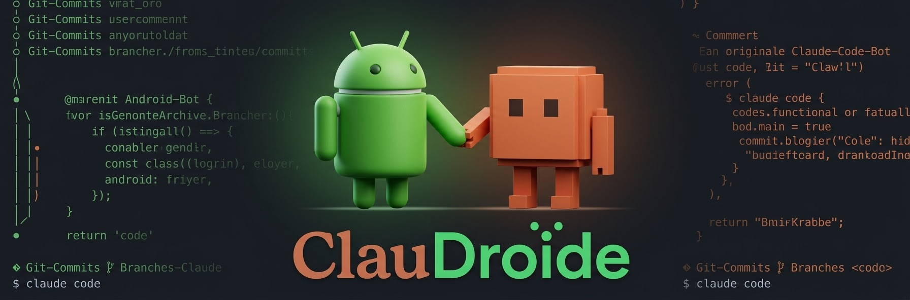
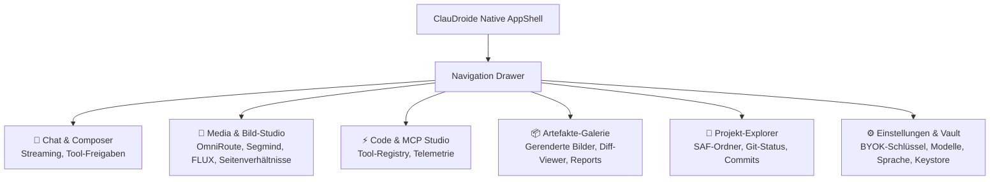
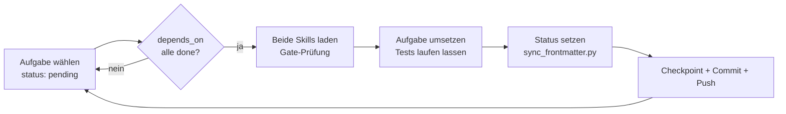
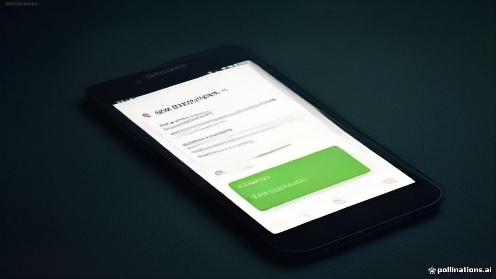
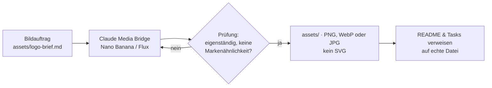

# ClauDroide

<p align="center">
  
</p>

<p align="center">
  <a href="assets/brand/1791468217945.jpg">
    
  </a>
  <br>
  <b>ClauDroide</b> — Autonomer mobiler KI-Coding-Assistent für Android
  <br>
  <sub>Native Material 3 Touch-Bedienung · BYOK-Sicherheits-Vault · OmniRoute &amp; Segmind Media Bridge · Google Stitch Architektur · Galaxy A56 optimiert</sub>
</p>

<p align="center">
  <a href="README.md">🇺🇸 English</a> · <b>🇩🇪 Deutsch</b>
</p>

<p align="center">
  
  
  
  
  
  
  
  
</p>

---

## ⚡ Kernfunktionen &amp; Fähigkeiten

- 🤖 **Vollwertiges mobiles Entwickler-Studio:** Eine vollwertige native Android-Oberfläche im Stil von Claude Code — keine reine Terminalansicht. Bietet Live-Token-Telemetrie, syntax-hervorgehobene Diff-Karten, interaktive Tool-Freigaben und Dateibaum-Navigation.
- 🎨 **Google Stitch High-Fidelity Design System:** Direkt aus dem verifizierten Stitch-Design-System (`Claudroide Android AI Workspace` via Google AI Pro) abgeleitet: Schiefergraues Canvas (`#0E1116`), warme Terrakotta-Akzente (`#E07A5F`), Edge-to-Edge Systemleisten und ergonomische 48dp Touch-Ziele.
- 🌉 **OmniRoute &amp; Multi-Provider Media Bridge:** Native Brücke zu OmniRoute (`127.0.0.1:20128`), Segmind (`flux-schnell`, `sdxl1.0`, `sd3.5`), Nano Banana 2 und schlüsselloser Pollinations-Fallback für autonome Bild- und Mediengenerierung direkt am Gerät.
- 🔒 **Hardware-abgesicherte BYOK-Architektur:** Echte offizielle Entwickler-APIs mit Android Keystore Verschlüsselung (StrongBox / TEE AES-256-GCM) und strikter Storage Access Framework (SAF) Ordner-Isolation.

---

## 📱 Interaktive Workspace-Navigation



---

<details open>
<summary><b>🚀 Schnellstart &amp; Lokaler A56 Workflow</b></summary>

### 1. Start in Termux / PRoot auf dem Galaxy A56
```bash
cd /home/mert/claudroide-next
cdx status      # Prüft Toolchain, Arbeitsspeicher und Git-Stand
cdx check       # Führt schnelle Unit-Tests und Secret-Gate aus
cdx test fast   # Führt zielgerichtete Fast-Test-Suiten aus
cdx build debug # Baut Debug-APK mit nativem aapt2 aarch64
```

### 2. Autonome Arbeitsfortsetzung
```bash
claude          # Startet Claude Code
/claudroide-resume  # Prüft Checkpoint und setzt Arbeit nahtlos fort
```
</details>

<details>
<summary><b>🌉 OmniRoute &amp; Segmind Mediengenerierung</b></summary>

ClauDroide kommuniziert mit lokalen und Cloud-Modellen über OmniRoute auf Port `20128` sowie direkte Medien-Pipelines:

| Anbieter | Unterstützte Modelle | Fähigkeiten | Status |
|---|---|---|---|
| **OmniRoute** (`localhost:20128`) | `segmind/flux-schnell`, `pollinations/flux`, `agy/gemini-3.1-flash-image`, `sdxl1.0` | Text-zu-Bild, Multi-Model Routing, Tool-Aufrufe | 🟢 Aktiv |
| **Segmind Direct** | `flux-schnell`, `flux-dev`, `sd3.5-large`, `wan2.1-t2v` | Schnelle Bild- &amp; Video-Pipelines | 🟢 Unterstützt |
| **Pollinations.ai** | `flux`, `turbo` | Schlüsselloser Fallback mit 100% Verfügbarkeit | 🟢 Konfiguriert |
| **Google Antigravity** | `gemini-3.1-flash-image`, `imagen-3.0` | High-Fidelity Rendering via Google AI Pro | 🟢 Verbunden |

Erzeugte Grafiken werden in `app_data/generated_media/` abgelegt und sind sofort in der **Artefakte-Galerie** abrufbar.
</details>

<details>
<summary><b>📊 135/135 Bauaufgaben Verifikationsstand</b></summary>

| Bereich | Aufgaben | Status |
|---|---|---|
| W0–W2 · Fundamente, Machbarkeit, Hardware-Profil | 001–008 | 🟢 8 / 8 Erledigt (W0–W2 Geschlossen) |
| W3–W6 · Kernarchitektur, Build-Pipelines, Tokens | 009–024 | 🟢 16 / 16 Erledigt (W3–W6 Geschlossen) |
| W7–W9b · Compose UI &amp; Interaktiver Chat | 025–042 | 🟢 18 / 18 Erledigt (W7–W9b Geschlossen) |
| W10–W14 · Modell-Anbieter, Routing &amp; Datenschutz | 043–069 | 🟢 27 / 27 Erledigt (W10–W14 Geschlossen) |
| W15–W19b · Agenten-Ausführung &amp; Kontext (SAF) | 070–094 | 🟢 25 / 25 Erledigt (W15–W19b Geschlossen) |
| W20–W23 · Git-Integration &amp; Sandbox-Ausführung | 095–105 | 🟢 11 / 11 Erledigt (W20–W23 Geschlossen) |
| W24–W26 · Security Engine, Freigaben &amp; Vault | 106–122 | 🟢 17 / 17 Erledigt (W24–W26 Geschlossen) |
| W27–W29 · Dynamische Skills &amp; E2E-Suite | 123–135 | 🟢 13 / 13 Erledigt (W27–W29 Geschlossen) |

Alle 2.612 Unit-Tests bestanden (`:app:testDebugUnitTest`). Release-APK verifiziert mit Schema v2 Signatur (`29616268...`).
</details>

**Inhalt:** [Schnellstart](#schnellstart-in-claude-code) · [Wie der Bau abläuft](#wie-der-bau-abläuft) · [Status](#status) · [Bilder & Maskottchen](#bilder-und-maskottchen) · [Grenzen](#sicherheits--und-produktgrenzen) · [Dokumente](#alle-dokumente)

---

## Schnellstart in Claude Code

```bash
cd /home/mert/claudroide-next   # Projektordner öffnen
claude                      # Claude Code starten (CLAUDE.md wird automatisch geladen)
```

Dann in der Claude-Code-Eingabe:

| Eingabe | Wirkung |
|---|---|
| `/claudroide-resume` | Prüft den letzten Stand in `progress/BUILD-STATE.md` gegen die echten Dateien und baut genau dort weiter. |
| `Baue weiter bis zum finalen Produkt` | Startet die autonome Bau-Schleife aus `CLAUDE.md`: nächste freigegebene Aufgabe → umsetzen → testen → Checkpoint → Commit/Push → nächste Aufgabe. Anhalten tut Claude nur bei Sicherheitsgates, fehlenden Schlüsseln/Werten oder zweimal fehlgeschlagenen Tests. |
| `Baue Aufgabe 017` | Nur diese eine Aufgabe umsetzen. |

Voraussetzungen: `git` und die verifizierte private Remote `mertgoevse-wq/claudroide` (ist eingerichtet). Die sechs global installierten Skills (`swarm-planner`, `parallel-task`, `adaptive`, `android-profiler`, `android-permissions-security`, `testing-setup`) lädt Claude je Aufgabe selbst.

<details>
<summary><b>Nach einem Absturz (App, Termux, Gerät) wieder weitermachen</b></summary>

1. Gerät neu starten, Termux/Debian öffnen, in den Projektordner wechseln.
2. `claude` starten.
3. `/claudroide-resume` eingeben.

Der Skill vergleicht Checkpoint, Dateien und Git-Stand und ratet nicht. Deshalb ist es wichtig, dass jeder abgeschlossene Aufgabenblock vorher committed wurde — das macht die Bau-Schleife automatisch.
</details>

---

## Wie der Bau abläuft



- **Wellen statt Chaos:** `tasks/DEPENDENCIES.md` teilt die 135 Aufgaben in Wellen W0–W29. Unabhängige Aufgaben darf Claude parallel bauen (mit `/parallel-task`), eine leitende Sitzung führt zusammen.
- **Maschinenlesbare Aufgaben:** Jede Task-Datei trägt einen YAML-Kopf mit `status`, `depends_on`, `skills`, `wave`, `gate`. Das Skript [`tools/sync_frontmatter.py`](tools/sync_frontmatter.py) hält alle 135 Dateien, die Wellen und die Skill-Matrix synchron — handgepflegte Widersprüche sind damit ausgeschlossen.
- **Kein Stillstand nach Abbruch:** Nach jedem Block wird `progress/BUILD-STATE.md` aktualisiert und gepusht.

<details>
<summary><b>Befehle für die Repo-Pflege</b></summary>

```bash
python3 tools/sync_frontmatter.py --check            # Konsistenz prüfen (CI tut das auch)
python3 tools/sync_frontmatter.py                    # Abweichungen reparieren
python3 tools/sync_frontmatter.py --status 017=done  # Aufgabe 017 als erledigt markieren
```

`--status ID=done` gilt erst als verifiziert, wenn der Dateiinhalt danach unverändert bleibt (`done_since_last_edit`); eine spätere Änderung stuft die Aufgabe automatisch auf `in_progress` zurück.
</details>

---

## Status

Die Zählung unten kommt aus den Frontmatter-Köpfen und wird vom Sync-Skript geprüft.

| Bereich | Aufgaben | Stand |
|---|---|---|
| W0–W2 · Grundlagen, Machbarkeit, Geräteprüfung | 001–008 | 🟢 8 / 8 erledigt (W0–W2 abgeschlossen) |
| W3–W6 · App-Grundlage, Baupfade, Gestaltung | 009–024 | 🟢 16 / 16 erledigt (W3–W6 abgeschlossen) |
| W7–W9b · Oberfläche und Chat | 025–042 | 🟢 18 / 18 erledigt (W7–W9b abgeschlossen) |
| W10–W14 · Anbieter, Modelle, Datenschutz | 043–069 | 🟢 27 / 27 erledigt (W10–W14 abgeschlossen) |
| W15–W19b · Agent und Projektzugriff | 070–094 | 🟢 25 / 25 erledigt (W15–W19b abgeschlossen) |
| W20–W23 · Git und Befehle | 095–105 | 🟢 11 / 11 erledigt (W20–W23 abgeschlossen) |
| W24–W26 · Sicherheitskern, Freigaben | 106–122 | 🟢 17 / 17 erledigt (W24–W26 abgeschlossen) |
| W27–W29 · Skills, externe Tools, Abschluss | 123–135 | 🟢 13 / 13 erledigt (W27–W29 abgeschlossen) |

<details>
<summary><b>Alle Wellen im Detail (W0–W29)</b></summary>

| Welle | Aufgaben | Vorgänger |
|---|---|---|
| W0 Einstieg | 001, 002, 003, 006 | — |
| W1 Machbarkeit | 004, 005, 009, 019 | 001, 002, 003 |
| W2 Geräte-/Bauprüfung | 007, 008 | 006 (+002) |
| W3 App-Grundlage | 010 | 009, 019 |
| W4 Baupfade | 011, 012 | 008 |
| W5 Einrichtung | 013–018 | 010 |
| W6 Gestaltung | 020–024 | 003, 019 |
| W7 UI-Grundlagen | 025–030 | 010, 023, 024 |
| W8 Chat | 031–035, 037, 042 | 025, 016 |
| W9 Chat-Laufzeit | 038, 039 | 031, 035 |
| W9b Streaming | 036 | 031, 035, 047, 052, 059 |
| W10 Anbietergrundlage | 043–045, 060 | 005, 016, 017 |
| W11 Anbieterhärtung | 046, 047, 052, 055–059 | 044, 045 |
| W12 Konkrete Anbieter | 048–051, 053, 054 | 004, 005, 047, 052, 059 |
| W13 Modell & Kontext | 061, 062, 065, 067 | 043, 055 |
| W13b Fallback | 063 | 062, 064, 065 |
| W13c Kostenanzeige | 041, 064 | 043, 055 (+061/+002) |
| W14 Offline/Daten | 066, 068, 069 | 039, 042, 062, 067 |
| W15 Agent-Grundlage | 070, 071 | 048–054 (+001) |
| W16 Agent-Ausführung | 040, 072–076, 078–080 | 070, 071 |
| W17 Agent-Erweiterung | 077 | 073, 078, 090, 099 |
| W18 Projektzugriff | 081, 082, 084, 087, 088, 092 | 010, 017 |
| W18b Projektanweisungen | 093 | 003, 122 |
| W19 Zugriffsfolgen | 083, 085, 086, 089, 091, 094 | 082 u. a. |
| W19b Dateiannahme | 090 | 088, 089, 119, 120 |
| W20 Git-Grundlage | 095, 098, 103 | 017, 045, 059 |
| W21 Git-Schreibpfad | 096, 097, 099, 100, 102, 104 | 095 u. a. |
| W22 Git-Upload | 101 | 095–100 |
| W23 Befehlsmachbarkeit | 105 | 007, 008, 010, 017 |
| W24 Sicherheitskern | 117–122, 125–127 | 017, 045 |
| W25 Befehle & Tests | 106, 107, 110–112, 114 | 105, 119, 120 |
| W26 Freigaben & Laufzeit | 108, 109, 113, 115, 116 | 017, 018, 105, 107 |
| W27 Skills | 123, 124, 129–131 | 001, 002, 017 |
| W28 Agents/externe Tools | 132–135 | 070, 117, 119, 122 |
| W29 Gesamttests | 128 | viele — startet zuletzt |

Maßgeblich sind die Einzeln-Abhängigkeiten in [`tasks/DEPENDENCIES.md`](tasks/DEPENDENCIES.md) und im Frontmatter jeder Datei, nicht diese Übersicht.
</details>

---

## Benutzeroberfläche & Mobile Nutzung

<p align="center">
  
</p>

ClauDroide bietet eine native Touch-Entwicklungserfahrung auf Basis von Jetpack Compose & Material 3:
- **Interaktiver Chat & Terminal:** Echtzeit-Streaming-Assistent, Syntax-hervorgehobene Code-Diff-Blöcke, Shell-Werkzeugausgaben und Stopp-Steuerung.
- **Projekt-Arbeitsbereiche (SAF):** Storage Access Framework mit abgegrenzten Verzeichnisbäumen, persistenten URI-Rechten und ohne Root-Bedarf.
- **BYOK-Schlüsselspeicher:** Hardware-gesicherte Speicherung im Android Keystore mit AES-Verschlüsselung für Claude API, OpenRouter und eigene Endpunkte.
- **Autonome Subagenten & Sicherheits-Tore:** Feste Schutz-Gates für Git-Commits, Push-Vorgänge und riskante Befehle mit klarer manueller Freigabe.

---

## Bilder und Maskottchen

Grafiken (Logo, App-Icon, Illustrationen, Banner) entstehen über die **Claude Media Bridge** des Nutzers. Regelkette, damit kein KI-Slop entsteht:



- **Signet:** [`assets/brand/mark-1024.png`](assets/brand/mark-1024.png), dazu die Varianten `-256` und `-96`. Wird außerdem direkt als adaptives App-Symbol erzeugt (`app/src/main/res/mipmap-*/ic_launcher_foreground.png`, mit `monochrome`-Ebene für die thematisierten Symbole ab Android 13).
- **Banner:** [`assets/brand/banner.png`](assets/brand/banner.png) — 1376x768, 16:9. Die Wortmarke ist echtes Inter, der Produktname ist deshalb konstruktionsbedingt richtig geschrieben.
- **In der App:** Beides liegt als WebP daraus abgeleitet im Build — `res/drawable-nodpi/claudroide_mark.webp` (31 KB) und `claudroide_banner.webp` (27 KB, aus 114 KB). Die PNGs bleiben als verlustfreie Quelle im Repo; der Deckel von 50 KB gilt für das, was aufs Gerät geht, und `BrandAssetContractTest` prüft ihn je ausgelieferter Datei.
- **Gestaltung:** eine Android-Kuppel in `#3DDC84` mit einem Claude-Funken als Krone. Die beiden Strahlen bei ±26° sind zugleich die Antennen des Droiden **und** zwei Strahlen des Funkens — dieselben Striche tragen beide Systeme, sodass sich keine Hälfte löschen lässt, ohne die andere zu zerstören. Das ist die Vorgabe „kein untergeordnetes Symbol" als Geometrie, nicht als Bildunterschrift.
- Als exakte Vektorgeometrie von [`tools/brand.py`](tools/brand.py) gezeichnet, nicht von einem Bildmodell: die Wortmarke muss „ClauDroide" schreiben, und Diffusionsmodelle schreiben Wortmarken falsch. Banner und App-Symbol importieren dieselbe Geometrie und können deshalb nicht auseinanderlaufen.
- Kein SVG als fertiges Logo oder Illustration. Fertige Grafiken liegen ausschließlich als PNG, WebP oder JPG vor (geprüft durch CI `.github/workflows/repo-health.yml`). Die SVGs unter `assets/brand/.build/` sind Build-Eingang, keine ausgelieferten Dateien. Quelldateien unter `assets/brand/` sind unbeschränkt; der 50-KB-Deckel gilt für ausgelieferte App-Ressourcen und ist testgeprüft.

---

## Sicherheits- und Produktgrenzen

- Eigener Name, eigene Bildsprache — keine Imitation von Claude, Anthropic oder bekannten Terminal-Maskottchen.
- Claude-Zugang in der App nur mit eigenem API-Schlüssel (BYOK). Kein Abo-Login, kein Token-Relay. OpenRouter, OpenCode, Antigravity (agy) und eigene Endpunkte nur auf offiziell dokumentierten Wegen.
- Schlüssel verschlüsselt auf dem Gerät, Geheimnis-Scan vor jedem Push, Push nur an dieses verifizierte private Repository.
- NPU-Beschleunigung, lokale KI und Bau direkt am A56 sind geprüfte Machbarkeitspunkte (Aufgaben 007, 011, 105) — keine zugesagten Funktionen, bis sie am echten Gerät belegt sind.

---

## Alle Dokumente

| Dokument | Inhalt |
|---|---|
| [`claudroide-spec.md`](claudroide-spec.md) | Hauptspezifikation: Produktziele, Grenzen, Prüfkriterien, 135 Aufgaben |
| [`tasks/`](tasks/) | 135 Aufgabendateien mit Frontmatter (`status`, `depends_on`, `skills`) |
| [`tasks/DEPENDENCIES.md`](tasks/DEPENDENCIES.md) | Wellen W0–W29, Sperrkanten, Parallel-Regeln |
| [`tasks/skill-matrix.md`](tasks/skill-matrix.md) | Zwei Skills pro Aufgabe, Quellen, Sicherheitsbefund |
| [`CLAUDE.md`](CLAUDE.md) | Regeln für Claude Code: Bau-Schleife, Skills, Medien, Repo-Pflege |
| [`tools/sync_frontmatter.py`](tools/sync_frontmatter.py) | Sync-Skript für Frontmatter und Status |
| [`progress/BUILD-STATE.md`](progress/BUILD-STATE.md) | Letzter verifizierter Arbeitsstand (Checkpoint) |
| [`.claude/skills/claudroide-resume/SKILL.md`](.claude/skills/claudroide-resume/SKILL.md) | `/claudroide-resume` nach Abbruch |
| [`assets/logo-brief.md`](assets/logo-brief.md) | Bildauftrag für die Media Bridge |
| [`.github/workflows/repo-health.yml`](.github/workflows/repo-health.yml) | CI: prüft Aufgabenzahl und Frontmatter-Konsistenz |
